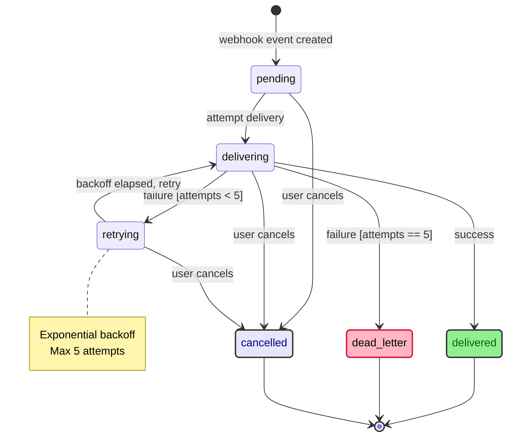

# Webhook Delivery Retry — Design Spec

_Spec fictícia gerada para validar o fluxo de Diagram Enrichment do `super.brainstorming`. Não corresponde a uma feature real._

## Visão Geral

Hoje a entrega de webhooks é "fire-and-forget": se o endpoint do cliente responder com erro ou timeout, o evento é descartado e o cliente perde a notificação sem qualquer sinal de falha. Esta feature adiciona um mecanismo de retry com backoff exponencial (até 5 tentativas) e um estado terminal de dead-letter para eventos que esgotam as tentativas, permitindo reprocessamento manual.

## Características Arquiteturais

**Priorizadas (top 3):**

| Característica | Por quê (preocupação de domínio) | Critério mensurável |
|---|---|---|
| Reliability | Cliente não pode perder notificação de pagamento por falha transitória do endpoint dele | 5 tentativas com backoff antes de dead-letter |
| Observability | Suporte precisa saber por que um webhook não chegou sem grepar logs | Todo evento tem estado consultável (`pending`/`delivering`/`retrying`/`delivered`/`dead_letter`/`cancelled`) |
| Testability | Backoff exponencial é fácil de acertar errado (off-by-one, overflow) | Cada transição de estado tem teste isolado |

**Consideradas, não priorizadas:** throughput (volume atual não justifica fila dedicada), multi-tenant rate limiting (fora do escopo desta iteração).

## Arquitetura / Fluxo

O ciclo de vida de um evento de webhook passa pelos estados `pending`, `delivering` e `retrying`, e termina em um de três estados terminais: `delivered`, `dead_letter` ou `cancelled`.

Quando um evento é criado, ele começa em `pending`. Ao ser processado, ele passa para `delivering`, onde uma tentativa de entrega é feita contra o endpoint do cliente. Se a entrega tiver sucesso, o evento vai para `delivered`, que é terminal. Se a entrega falhar e o número de tentativas ainda for menor que 5, o evento vai para `retrying`; se a falha ocorrer já na quinta tentativa, o evento vai direto para `dead_letter`, também terminal. Quando o tempo de backoff de um evento em `retrying` termina, ele volta para `delivering` para uma nova tentativa — esse ciclo entre `delivering` e `retrying` pode se repetir até o limite de tentativas ser atingido. O backoff entre tentativas é exponencial (1min, 2min, 4min, 8min, 16min), com teto de 5 tentativas.

Em qualquer momento antes de o evento alcançar um estado terminal — ou seja, estando em `pending`, `delivering` ou `retrying` — o usuário pode cancelar o evento manualmente, movendo-o para `cancelled`, que também é terminal.

O diagrama abaixo é um complemento visual da descrição acima, não um substituto — ambos cobrem o mesmo ciclo de vida.

Diagrama fonte: `specs/diagrams/webhook-delivery-retry-design_01_state_retry_lifecycle.mmd`

## Decisões Arquiteturais

### D1. Backoff exponencial com teto de 5 tentativas, não fila de retry separada

- **Contexto:** Falhas de entrega podem ser transitórias (timeout momentâneo do endpoint do cliente) ou permanentes (endpoint desativado). Alternativas: backoff exponencial in-place, fila de retry dedicada (RabbitMQ/SQS), retry ilimitado.
- **Decisão:** Backoff exponencial (1min, 2min, 4min, 8min, 16min) com campo `attempts` no próprio registro do evento; sem fila separada.
- **Justificativa técnica:** O volume atual (baixas centenas de webhooks/dia) não justifica a complexidade operacional de uma fila dedicada; um job agendado revisitando eventos em `retrying` é suficiente.
- **Justificativa de negócio:** Menor custo de implementação e operação nesta fase; evita introduzir uma nova dependência de infraestrutura para um volume que não a demanda.
- **Trade-offs aceitos:** Se o volume crescer 100x, o job agendado deixa de escalar e uma fila dedicada será necessária — o revisit trigger é "p95 de eventos em `retrying` simultâneos > 500".

## Riscos

| Risco | Impacto (1-3) | Probabilidade (1-3) | Score | Mitigação |
|---|---|---|---|---|
| Job de retry falha silenciosamente e eventos ficam presos em `retrying` para sempre | 3 | 2 | 6 🟡 | Alerta se um evento fica em `retrying` por mais que o backoff máximo esperado (16min + margem) |
| Endpoint do cliente aceita o webhook mas processa errado (falso `delivered`) | 2 | 1 | 2 🟢 | Fora do escopo — é responsabilidade do cliente; documentar no contrato da API |
