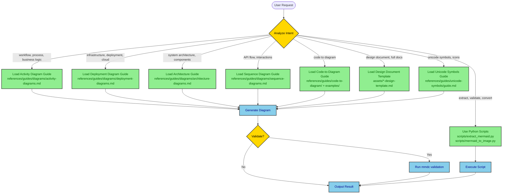
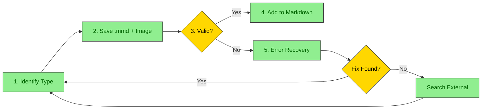
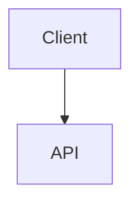

# Mermaid Architect - Hierarchical Diagram and Documentation Skill

Mermaid diagram and documentation system with specialized guides and code-to-diagram capabilities.

## Table of Contents

- [Decision Tree](#decision-tree)
- [Available Guides and Resources](#available-guides-and-resources)
- [Usage Patterns](#usage-patterns)
- [Resilient Workflow](#resilient-workflow)
- [Spec-Embedded Diagrams](#spec-embedded-diagrams)
- [Unicode Semantic Symbols](#unicode-semantic-symbols)
- [Python Utilities](#python-utilities)
- [Decision Tree Examples](#decision-tree-examples)
- [High-Contrast Styling](#high-contrast-styling)
- [File Organization](#file-organization)
- [Workflow Summary](#workflow-summary)
- [When to Use What](#when-to-use-what)
- [Best Practices](#best-practices)
- [Learning Path](#learning-path)

## Decision Tree

**How this skill works:**

1. **User makes a request** → Skill analyzes intent
2. **Skill determines diagram/document type** → Loads appropriate guide(s)
3. **AI reads specialized guide** → Generates diagram/document using templates
4. **Result delivered** → With validation and export options

**User Intent Analysis:**



## Available Guides and Resources

### Diagram Type Guides (`references/guides/diagrams/`)

| Guide | Full Path | Load When User Wants | Examples |
|-------|-----------|---------------------|----------|
| Activity Diagrams | `references/guides/diagrams/activity-diagrams.md` | Workflows, processes, business logic, user flows, decision trees | "Show checkout flow", "Document ETL pipeline", "Create approval workflow" |
| Deployment Diagrams | `references/guides/diagrams/deployment-diagrams.md` | Infrastructure, cloud architecture, K8s, serverless, network topology | "Show AWS architecture", "Document GCP deployment", "Create K8s diagram" |
| Architecture Diagrams | `references/guides/diagrams/architecture-diagrams.md` | System architecture, component design, high-level structure | "Show system components", "Document microservices", "Architecture overview" |
| Sequence Diagrams | `references/guides/diagrams/sequence-diagrams.md` | API interactions, service communication, request/response flows | "Show API call sequence", "Document auth flow", "Service interactions" |

### Code-to-Diagram Guide & Examples

| Resource | Full Path | What It Provides |
|----------|-----------|------------------|
| **Master Guide** | `references/guides/code-to-diagram/README.md` | Complete workflow for analyzing any codebase and extracting diagrams |
| **Spring Boot** | `examples/spring-boot/README.md` | Controller→Service→Repository architecture, deployment config, sequence from methods, activity from business logic |
| **FastAPI** | `examples/fastapi/README.md` | Python async patterns, Pydantic models, dependency injection, cloud deployment |
| **React** | `examples/react/README.md` | Component hierarchy, state management, data flow, build pipeline |
| **Python ETL** | `examples/python-etl/README.md` | Data pipeline, transformation steps, error handling, scheduling |
| **Node/Express** | `examples/node-webapp/README.md` | Middleware chain, route handlers, async patterns, deployment |
| **Java Web App** | `examples/java-webapp/README.md` | Traditional MVC, servlet containers, WAR deployment |

### Design Document Templates

| Template | Full Path | Use For | Load When |
|----------|-----------|---------|-----------|
| Architecture Design | `assets/architecture-design-template.md` | System-wide architecture | "Create architecture doc", "Document system design" |
| API Design | `assets/api-design-template.md` | API specifications | "API design doc", "Document REST API" |
| Feature Design | `assets/feature-design-template.md` | Feature planning | "Feature design", "Plan new feature" |
| Database Design | `assets/database-design-template.md` | Database schema | "Database design", "Document schema" |
| System Design | `assets/system-design-template.md` | Complete system | "System design doc", "Full system documentation" |

### Unicode Symbols Guide

**Full Path:** `references/guides/unicode-symbols/guide.md`

**Load when user mentions:** "unicode symbols", "emoji in diagrams", "semantic icons", "add symbols"

**Quick Reference:**
- 📦 Infrastructure: ☁️ 🌐 🔌 📡 🗄️
- ⚙️ Compute: ⚙️ ⚡ 🔄 ♻️ 🚀 💨
- 💾 Data: 💾 📦 📊 📈 🗃️ 🧊
- 📨 Messaging: 📨 📬 📤 📥 🐰 📢
- 🔐 Security: 🔐 🔑 🛡️ 🚪 👤 🎫
- 📝 Monitoring: 📝 📊 🚨 ⚠️ ✅ ❌

### Python Scripts (`scripts/`)

| Script | Use For | Load When |
|--------|---------|-----------|
| `extract_mermaid.py` | Extract diagrams from Markdown, validate syntax, replace with images | "extract diagrams", "validate mermaid", "find all diagrams" |
| `mermaid_to_image.py` | Convert .mmd to PNG/SVG, batch conversion, custom themes | "convert to image", "render diagram", "create PNG" |
| `resilient_diagram.py` | Full workflow: save .mmd, generate image, validate, error recovery | "generate diagram", "create diagram with validation", "resilient diagram" |

## Usage Patterns

Common request patterns and guide selection. See [When to Use What](#when-to-use-what) for complete mapping.

| Pattern | Example Request | Guides to Load |
|---------|-----------------|----------------|
| Single Diagram | "Create activity diagram for login flow" | Diagram type guide + Unicode symbols |
| Code-to-Diagram | "Generate deployment from application.yml" | Framework example + Deployment guide |
| Design Document | "Create API design document" | Template from assets/ + Relevant diagram guides |
| Extract/Validate | "Extract diagrams from design.md" | Use `scripts/extract_mermaid.py` |
| Batch Convert | "Convert all .mmd to PNG" | Use `scripts/mermaid_to_image.py` |

## Resilient Workflow

**CRITICAL:** This is the recommended approach for ALL diagram generation. It ensures validation, error recovery, and consistent file organization.

**Full Guide:** `references/guides/resilient-workflow.md`

### Workflow Overview



### Key Principle

**NEVER add a diagram to markdown until it passes validation.** This prevents broken diagrams in documentation.

### Using the Script (Recommended)

```bash
# Generate with full error recovery
python <super.design-doc-mermaid-base-dir>/scripts/resilient_diagram.py \
    --code "flowchart TD; A-->B" \
    --markdown-file design_doc \
    --diagram-num 1 \
    --title "process_flow" \
    --format png \
    --json
```

**Output:** Both `.mmd` and `.png` files in `./diagrams/` directory.

### File Naming, Error Recovery & Manual Fallback

File-naming convention (`./diagrams/<markdown_file>_<num>_<type>_<title>.{mmd,png}`), the error-recovery ladder (troubleshooting guide → `perplexity_ask` → `brave_web_search` → `gemini` → `WebSearch`), and the manual fallback steps when the script is unavailable are all in **`references/guides/resilient-workflow.md`** — load it on a generation failure or when you need the exact naming/recovery detail. On the happy path, run the `resilient_diagram.py` invocation above and it handles naming, validation, and recovery for you.

### Pattern 6: Resilient Diagram Generation

**User:** "Create a sequence diagram and add it to the design doc"

**Skill Actions:**
1. Identify intent: **diagram generation** + **markdown integration**
2. Load workflow guide: `references/guides/resilient-workflow.md`
3. Identify diagram type: **sequence**
4. Load diagram guide: `references/guides/diagrams/sequence-diagrams.md`
5. Generate Mermaid code using templates
6. Execute resilient workflow:
   ```bash
   python <super.design-doc-mermaid-base-dir>/scripts/resilient_diagram.py \
       --code "[generated code]" \
       --markdown-file design_doc \
       --diagram-num 1 \
       --title "api_sequence" \
       --json
   ```
7. If validation fails → Apply troubleshooting fix → Retry
8. On success → Add `` to markdown

## Spec-Embedded Diagrams

When a diagram is generated for a **superpowers spec** (a brainstorming design doc under `docs/superpowers/<feature>/specs/`), two defaults change from the general case above.

### 1. Output directory is spec-relative, not CWD-relative

Pass `--output-dir` pointing at a `diagrams/` folder **nested inside the spec's own directory**, mirroring how superpowers already scopes `research/`, `prd/`, `plans/`, and `qa/` per feature:

```
docs/superpowers/<feature>/specs/
├── <feature>-design.md
└── diagrams/
    ├── <feature>-design_01_flowchart_<title>.mmd
    └── <feature>-design_01_flowchart_<title>.png   (only if not --no-image)
```

**Never** write to a shared top-level `docs/diagrams/` — diagrams belong next to the spec that consumes them, not in a directory shared across unrelated specs.

### 2. Embed mode for diagrams read by another model

A diagram inside a spec is frequently consumed by another agent/model in the pipeline (PRD generation, plan writing, review), not opened as an image by a human. For that case, use `--no-image`: the script still validates the Mermaid syntax via `mmdc` (rendering to a discarded temp file), but persists **only the `.mmd`** — no PNG.

```bash
python <super.design-doc-mermaid-base-dir>/scripts/resilient_diagram.py \
    --code "flowchart TD; A[Client] --> B[API]" \
    --markdown-file account-profile-edit-design \
    --diagram-num 1 \
    --title "request_flow" \
    --output-dir docs/superpowers/account-profile-edit/specs/diagrams \
    --no-image \
    --json
```

On success, embed the **raw mermaid** directly in the spec — do not add an `` image reference in this mode:

````markdown
### Request Flow


````

The persisted `.mmd` under `specs/diagrams/` remains the traceable source if the diagram is later edited or needs to be rendered as an image (e.g. for a PR description or external doc).

### Image mode vs embed mode

| Scenario | Flag | Result |
|---|---|---|
| Diagram will be viewed by a human in a rendered doc (GitHub preview, Confluence) | *(default, no `--no-image`)* | `.mmd` + `.png` under `<spec-dir>/diagrams/`; markdown gets `` |
| Diagram is embedded in a spec consumed by other agents/models in the superpowers pipeline | `--no-image` | Only `.mmd` persisted under `<spec-dir>/diagrams/`; markdown gets the raw fenced ` ```mermaid ` block inline |

## Unicode Semantic Symbols

Always use Unicode symbols to enhance diagram clarity. Common patterns:

Common symbols: 👤 user, 🌐 gateway/load-balancer, ⚙️ service/worker, 💾 database, ⚡ cache, 🔐 auth, 📋 order/list, 📬 queue, 📦 storage, 🚀 start, ✓/✅ valid/complete, ❌ error. Rendered examples (infrastructure, activity flow, microservices) and the full symbol table live in the guide below.

**For complete symbol reference, load:** `references/guides/unicode-symbols/guide.md`

## Python Utilities

### Extract Mermaid Diagrams

```bash
# List all diagrams
python <super.design-doc-mermaid-base-dir>/scripts/extract_mermaid.py document.md --list-only

# Extract to separate files
python <super.design-doc-mermaid-base-dir>/scripts/extract_mermaid.py document.md --output-dir diagrams/

# Validate all diagrams
python <super.design-doc-mermaid-base-dir>/scripts/extract_mermaid.py document.md --validate

# Replace with image references (for Confluence upload)
python <super.design-doc-mermaid-base-dir>/scripts/extract_mermaid.py document.md --replace-with-images \
  --image-format png --output-markdown output.md
```

### Convert to Images

```bash
# Single conversion
python <super.design-doc-mermaid-base-dir>/scripts/mermaid_to_image.py diagram.mmd output.png

# With custom settings
python <super.design-doc-mermaid-base-dir>/scripts/mermaid_to_image.py diagram.mmd output.svg \
  --theme dark --background white --width 1200

# Batch convert directory
python <super.design-doc-mermaid-base-dir>/scripts/mermaid_to_image.py diagrams/ output/ --format png --recursive

# From stdin
echo "graph TD; A-->B" | python <super.design-doc-mermaid-base-dir>/scripts/mermaid_to_image.py - output.png
```

## Decision Tree Examples

Three worked walkthroughs — a workflow request → activity diagram, Spring Boot code → multi-diagram output, and GCP infrastructure → deployment diagram — are in **`references/guides/decision-tree-examples.md`**. The decision criteria themselves live in the [Decision Tree](#decision-tree) above; load the examples reference only when you want a concrete application of them.

## High-Contrast Styling

**ALL diagrams MUST use high-contrast colors:**

```mermaid
graph TB
    classDef primary fill:#90EE90,stroke:#333,stroke-width:2px,color:darkgreen
    classDef secondary fill:#87CEEB,stroke:#333,stroke-width:2px,color:darkblue
    classDef database fill:#E6E6FA,stroke:#333,stroke-width:2px,color:darkblue
    classDef error fill:#FFB6C1,stroke:#DC143C,stroke-width:2px,color:black

    %% Every classDef MUST have color: property
```

**Rules:**
- Light background → Dark text color
- Dark background → Light text color
- Always specify `color:` in every `classDef`

## File Organization

Top level: `SKILL.md` (orchestrator) + `references/` (guides, loaded on-demand) + `assets/` (design doc templates) + `scripts/` (Python utilities: `extract_mermaid.py`, `mermaid_to_image.py`, `resilient_diagram.py`) + `examples/` (per-framework patterns: spring-boot, fastapi, react, python-etl, node-webapp, java-webapp).

**Full directory tree:** `references/guides/file-organization.md`

## Workflow Summary

1. **Analyze user intent** → Determine diagram type, document type, or action needed
2. **Load appropriate guide(s)** → Read only what's needed (token efficient)
3. **Apply templates and patterns** → Use examples from guides
4. **Generate output** → Create diagram or document
5. **Validate** (optional) → Use scripts to verify
6. **Convert** (optional) → Export to images if needed

## When to Use What

| User Request | Load This |
|--------------|-----------|
| "activity diagram", "workflow", "process flow" | `references/guides/diagrams/activity-diagrams.md` |
| "deployment", "infrastructure", "cloud", "k8s" | `references/guides/diagrams/deployment-diagrams.md` |
| "architecture", "system design", "components" | `references/guides/diagrams/architecture-diagrams.md` + design template |
| "API", "sequence", "interactions", "flow" | `references/guides/diagrams/sequence-diagrams.md` |
| "Spring Boot code" | `examples/spring-boot/` + relevant diagram guides |
| "FastAPI code", "Python API" | `examples/fastapi/` + relevant diagram guides |
| "React app", "frontend" | `examples/react/` + architecture guide |
| "ETL", "data pipeline", "Python batch" | `examples/python-etl/` + activity guide |
| "symbols", "unicode", "emoji" | `references/guides/unicode-symbols/guide.md` |
| "syntax error", "diagram won't render", "troubleshoot" | `references/guides/troubleshooting.md` |
| "extract diagrams" | `scripts/extract_mermaid.py` |
| "convert to image", "PNG", "SVG" | `scripts/mermaid_to_image.py` |
| "create diagram", "generate diagram", "add diagram to markdown" | `scripts/resilient_diagram.py` + `references/guides/resilient-workflow.md` |
| "design document", "full docs" | `assets/*-design-template.md` + diagram guides |
| "diagram for a spec", "embed in brainstorming/design doc" | `scripts/resilient_diagram.py --no-image` + [Spec-Embedded Diagrams](#spec-embedded-diagrams) |

## Best Practices

1. **Single Responsibility**: One diagram = One concept
2. **Unicode Enhancement**: Always use semantic symbols for clarity
3. **High Contrast**: Never skip the `color:` property in styles
4. **Validate Early**: Use scripts to catch syntax errors
5. **Template Reuse**: Leverage existing templates and examples
6. **Load On-Demand**: Only read guides needed for the specific request
7. **Token Efficiency**: Use hierarchical loading instead of reading everything

## Learning Path

**New to Mermaid?** Start here:
1. Read `references/guides/unicode-symbols/guide.md` for symbol meanings
2. Read `references/guides/diagrams/activity-diagrams.md` for basic patterns
3. Try examples in `examples/spring-boot/` or `examples/fastapi/`
4. Use `scripts/extract_mermaid.py --validate` to check your work

**Need to document code?** Follow this:
1. Identify your framework → Load relevant `examples/{framework}/`
2. Match code pattern to diagram type
3. Use templates from guide
4. Validate with scripts

**Creating design docs?** Follow this:
1. Choose document type → Load template from `assets/`
2. Fill in text sections
3. Load diagram guides as needed for each section
4. Use Unicode symbols throughout
5. Save to `docs/design/` with timestamp

---

**Version:** 2.0 (Hierarchical Architecture)
**Last Updated:** 2025-01-13
**Maintained by:** Claude Code Skills
