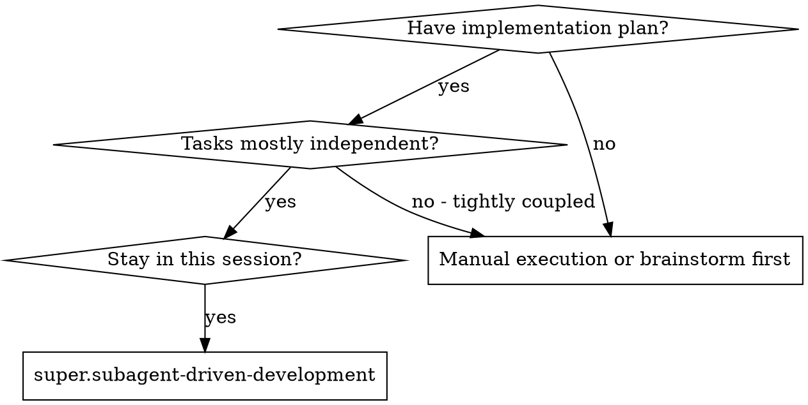

# Entry routing — is this skill the right mechanism for this feature?

Read at **entry only**. Once the plan is being executed, this file is settled: it answers "should
I be in this skill at all", never "what do I do next". That is why it is not in the eager SKILL.md
— on a mid-execution resume the question has already been answered, and the bytes would displace
the Execution Loop.

## Reverse tier mismatch guard

If you arrived here but the feature was classified **Micro/Small/Medium** at triage, **pause and
verify** before dispatching anything:

1. Did the user explicitly choose this skill ("execute com subagent-driven-development", "use
   fan-out", etc.)? If yes, proceed — the user overrode the default.
2. Did `super.using-superpowers` route here because the tasks index has `waveCount > 1`,
   `maxParallelWave > 1`, or the recommendation was fan-out? If yes, proceed.
3. Otherwise — the feature is Small/Medium and the route here was accidental — **route to
   `super.using-superpowers/references/medium-inline-path.md`** instead. Running a per-task fan-out
   for a Small/Medium feature wastes tokens and time without improving quality.

This guard prevents the inverse drift: fan-out being used for trivial features just because an
execution skill was invoked directly. It is the mirror of the forward tier guard in the SKILL.md
("do not dispatch a per-task implementer/reviewer for a Small/Medium feature").

## Decision flow

